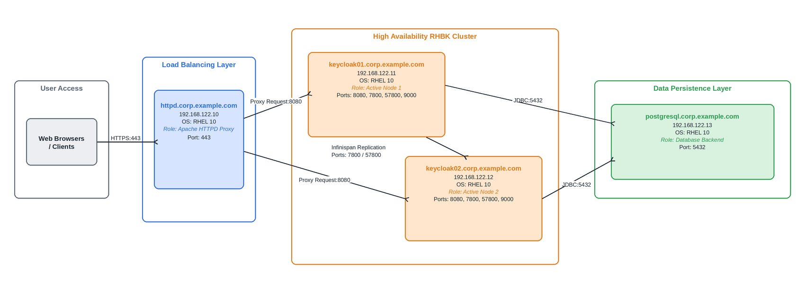

# Red Hat build of Keycloak Laboratory Automation

[](https://docs.ansible.com/)
[](https://www.redhat.com/en/technologies/linux-platforms/enterprise-linux)
[](./LICENSE)

Automated Ansible playbooks for deploying a High-Availability (HA) **Red Hat Build of Keycloak (RHBK)** environment on Red Hat Enterprise Linux.

> ⚠️ **Lab environment — not production-hardened.** This project is intended for
> learning and testing. It uses self-signed certificates, `NOPASSWD` sudo for the
> `devops` user, broadly opened firewall ports, and weak **example** credentials.
> Secrets are kept in [Ansible Vault](#2-secrets-ansible-vault) rather than plaintext,
> but the values in the shipped `*.example` templates are deliberately trivial — set
> strong passwords and your own vault password (plus apply proper PKI and
> least-privilege sudo) before using anything resembling this in production.

## Architecture Overview

The lab consists of 4 dedicated RHEL servers configured in a load-balanced layout:

- **Apache HTTPD** (`httpd.corp.example.com`) terminates TLS on port `443` and reverse-proxies
  traffic to the Keycloak nodes using `mod_proxy_balancer` (round-robin across the
  cluster members on port `8080`).
- **Two clustered RHBK nodes** (`keycloak01`/`keycloak02`) run active/active. They form
  an Infinispan/JGroups cluster over ports `7800` and `57800` for distributed caching
  and session replication, and expose the management/health endpoint on port `9000`.
- **A shared PostgreSQL backend** (`postgresql.corp.example.com`, port `5432`) stores all realm,
  user, and session persistence data for both Keycloak nodes.

> **Note on availability:** only the Keycloak tier is redundant. The HTTPD load balancer
> and the PostgreSQL database are each single points of failure in this topology.



> Diagram generated by [`docs/diagram.py`](./docs/diagram.py) — re-run it after changing hostnames, IPs, or ports.

## Topology & Network Specifications

| Hostname | IP Address | OS | Role | Primary Ports |
| :--- | :--- | :--- | :--- | :--- |
| `control-node` | `192.168.122.1` | - | Ansible Execution Environment Node | - |
| `httpd.corp.example.com` | `192.168.122.10` | RHEL 10 | Reverse Proxy / Load Balancer (Apache HTTPD) | 443 |
| `keycloak01.corp.example.com` | `192.168.122.11` | RHEL 10 | RHBK Active Node 1 | 8080, 7800, 9000 |
| `keycloak02.corp.example.com` | `192.168.122.12` | RHEL 10 | RHBK Active Node 2 | 8080, 7800, 9000 |
| `postgresql.corp.example.com` | `192.168.122.13` | RHEL 10 | Database Backend (PostgreSQL) | 5432 |

These hostnames and IPs are lab defaults. To adapt the layout to your own network, see
[Inventory & Host Addressing](#1-inventory--host-addressing) for exactly which files to edit.

## Prerequisites

Ensure the following tooling is installed on your control node prior to execution:

- **[Ansible](https://docs.ansible.com/ansible/latest/installation_guide/index.html)** — `ansible-core` 2.16+ (Ansible community package 9+), required by the `redhat.rhbk` and `redhat.rhel_system_roles` collections
- **[Ansible Navigator](https://ansible.readthedocs.io/projects/navigator/installation)** (1.1.0+)
- **[Podman](https://podman.io/)** (4.0+) - for running execution environments
- **Python 3.11+** on the control node
- **SSH connectivity** to all target hosts

### Required Ansible Collections

The playbook uses the following collections (automatically pulled from requirements.yaml):

- `redhat.rhel_system_roles` (v2.4.2) - RHEL system configuration
- `redhat.rhbk` (v3.0.2) - Red Hat Build of Keycloak deployment
- `community.postgresql` (v5.1.0) - PostgreSQL database management

Install collections by running:

```bash
ansible-galaxy collection install -r collections/requirements.yaml -p collections/
```

## Configuration Requirements

Before running the playbook, you must configure the following:

### 1. Inventory & Host Addressing

The `inventory` file is the **single source of truth** for which hosts exist, their
names, and their IPs. Edit it first:

```ini
[load_balancer]
httpd.lab.local ansible_host=192.168.122.10

[keycloak]
keycloak01.lab.local ansible_host=192.168.122.11
keycloak02.lab.local ansible_host=192.168.122.12

[database]
postgresql.lab.local ansible_host=192.168.122.13

[rhel10:children]
load_balancer
keycloak
database
```

- **Hostname** (left of each line) → becomes the managed host's `inventory_hostname`
  and is written into `/etc/hosts` on every node.
- **`ansible_host=`** → the **IP address** Ansible connects to, and the address the
  node's NIC is configured with (reused by `group_vars/all/main.yaml`). Change this to
  renumber a host.
- **Keep the group names** (`load_balancer`, `keycloak`, `database`) — the playbooks and
  `group_vars/` target them by name. You can add or remove `keycloak` nodes freely.

**Auto-derived — you do *not* edit these:** the HTTPD balancer members
(`templates/httpd/keycloak.conf.j2` loops over the `keycloak` group), `/etc/hosts`
(`templates/hosts.j2`), and each host's NIC address (taken from `ansible_host`).

#### Where IP addresses & hostnames live

If you move beyond simply renumbering hosts in the inventory, these are the **only**
other places that hardcode an IP, subnet, or `*.lab.local` name:

| What to change | File | Setting(s) |
| :--- | :--- | :--- |
| Per-host IPs & hostnames | `inventory` | `ansible_host=` and the hostname labels |
| Gateway, DNS, search domain | `group_vars/all/main.yaml` | `network_gateway`, `network_dns`, `network_search_domain` |
| NIC name & subnet size | `group_vars/all/main.yaml` | `interfaces[].name` (`enp1s0`), `prefix-length` (`24`) |
| Subnet allowed to reach PostgreSQL | `playbooks/postgresql.yaml` | `source: 192.168.122.0/24` (pg_hba rule) |
| Keycloak public URL | `group_vars/keycloak/main.yaml` | `rhbk_hostname` (`https://keycloak.lab.local`) |
| Keycloak → database JDBC URL | `group_vars/keycloak/main.yaml` | `rhbk_db_url` (DB hostname/port) |
| Apache `ServerName` & HTTP→HTTPS redirect | `templates/httpd/keycloak.conf.j2` | `ServerName`, `Redirect` target |
| TLS certificate subject & SANs | `files/ssl.conf` | `CN`, `IP.1`, `DNS.1`–`DNS.3` |
| TLS certificate filenames | `group_vars/load_balancer/main.yaml` + `templates/httpd/keycloak.conf.j2` | `certificates_files`, `SSLCertificate*File` |

> **Tip:** the lab uses the public hostname `keycloak.lab.local` for the load balancer.
> If you change it, update `rhbk_hostname`, the Apache `ServerName`/redirect, and the
> certificate (`files/ssl.conf` plus the `.crt`/`.key` filenames) together so they match.

**Note:** Ensure all hosts are reachable via SSH and have passwordless sudo configured or valid sudo credentials.

### 2. Secrets (Ansible Vault)

All passwords are kept in [Ansible Vault](https://docs.ansible.com/ansible/latest/vault_guide/index.html) files, never in plaintext in `group_vars/`. Each vault ships as a `*.example` template that you copy, fill in, and encrypt. The real `vault.yaml` files and the vault password file are **git-ignored**.

| Vault file | Variable | Used for |
| :--- | :--- | :--- |
| `group_vars/all/vault.yaml` | `vault_db_password` | PostgreSQL user password (`db_password`) and Keycloak JDBC password (`rhbk_db_pass`) |
| `group_vars/keycloak/vault.yaml` | `vault_rhbk_bootstrap_admin_password` | Keycloak initial admin password (`rhbk_bootstrap_admin_password`) |

The `group_vars/*/main.yaml` files reference these with `"{{ vault_... }}"`, so the plaintext secrets never enter version control.

#### Setup

```bash
# 1. Copy the templates and edit in your real passwords
cp group_vars/all/vault.yaml.example group_vars/all/vault.yaml
cp group_vars/keycloak/vault.yaml.example group_vars/keycloak/vault.yaml

# 2. Encrypt them
ansible-vault encrypt group_vars/all/vault.yaml group_vars/keycloak/vault.yaml

# 3. Store the vault password so ansible.cfg can read it
echo 'your-vault-password' > .vault_pass && chmod 600 .vault_pass
```

Ansible reads the password from `.vault_pass` via `vault_password_file` in `ansible.cfg`, so no `--ask-vault-pass` flag is needed.

#### Working with the vault

```bash
# View / edit an encrypted file
ansible-vault view group_vars/all/vault.yaml
ansible-vault edit group_vars/keycloak/vault.yaml

# Change the vault password and re-encrypt, then update .vault_pass
ansible-vault rekey group_vars/all/vault.yaml group_vars/keycloak/vault.yaml
```

### 3. Privilege Escalation Pcorp.example.comcorp.example.com

The playbook requires `sudo` privileges on remote hosts. Create a `devops_becomecorp.example.com` file:corp.example.comcorp.example.comcorp.example.comcorp.example.com

```bash
echo "your_sudo_password" > devops_become_password
chmod 600 devops_become_password
```

This file is referenced in `ansible.cfg` and contains the sudo password for the `devops` user.

### 4. Ansible Navigator Configuration

The `ansible-navigator.yml` file configures the execution environment:

- **Container Engine:** Podman (ensure it's running)
- **Execution Environment:** `registry.redhat.io/ansible-automation-platform-25/ansible-dev-tools-rhel8:latest`
- **Pull Policy:** `missing` (pulls image only if not present locally)

For offline execution, you may need to pre-pull the image:

```bash
podman pull registry.redhat.io/ansible-automation-platform-25/ansible-dev-tools-rhel8:latest
```

### 5. Network

Per-host IP addresses are defined once in the `inventory` file (`ansible_host`) and
reused by the shared network configuration in `group_vars/all/main.yaml`, which also
holds the gateway, DNS, search domain, NIC name, and subnet size. See
[Where IP addresses & hostnames live](#where-ip-addresses--hostnames-live) above for
the full list of files to adjust, and the
[Topology & Network Specifications](#topology--network-specifications) table for the
default layout.

### 6. SSH Configuration

Ensure SSH access to all hosts with the `devops` user:

```bash
# Test SSH connectivity
ansible all -i inventory -m ping
```

If using SSH keys instead of passwords, configure them in the inventory or `~/.ssh/config`.

## Running the Playbook

### Prerequisites Checklist

Before execution, verify all the following are complete:

- [ ] `inventory` file updated with correct hostnames and IP addresses
- [ ] `devops_become_password` file created and set with appropriate permissions
- [ ] Vault files created from the `*.example` templates, filled in, and encrypted; `.vault_pass` created (see [Secrets (Ansible Vault)](#2-secrets-ansible-vault))
- [ ] `group_vars/keycloak/main.yaml`, `group_vars/database/main.yaml`, and `group_vars/load_balancer/main.yaml` customized for your environment
- [ ] Certificates `keycloak.lab.local.crt` and `keycloak.lab.local.key` under the `files/` directory that match the host. The subject and SANs below match the provided `files/ssl.conf`; adjust them for your environment. Example for generating a self-signed certificate:
   ```
   openssl req -x509 -newkey rsa:4096 -sha256 -days 365 -noenc -keyout keycloak.lab.local.key -out keycloak.lab.local.crt -subj "/C=BR/ST=SP/L=Santo Antonio de Posse/O=Starscream/OU=IT/CN=keycloak.lab.local" -addext "subjectAltName=IP:192.168.122.10,DNS:keycloak.lab.local,DNS:keycloak,DNS:www.keycloak.lab.local"
   ```
- [ ] SSH connectivity verified with `ansible all -i inventory -m ping`

### Execution

Run the playbook using Ansible Navigator:

```bash
ansible-navigator run playbook.yaml
```

Or using traditional Ansible:

```bash
ansible-playbook playbook.yaml -i inventory
```

### What the Playbook Does

The main playbook executes the following phases in order:

1. **pre-setup.yaml** - System preparation (update packages, allow sudo without a password and configure /etc/hosts)
2. **postgresql.yaml** - Database installation and initialization
3. **rhbk.yaml** - RHBK installation and cluster configuration
4. **httpd.yaml** - Apache HTTPD reverse proxy and SSL setup

### Troubleshooting

For detailed debugging, enable verbose mode:

```bash
ansible-navigator run playbook.yaml -i inventory -vvv
```

Use systemd to check service status:

```bash
ansible keycloak -i inventory -m systemd -a "name=rhbk state=started"
ansible database -i inventory -m systemd -a "name=postgresql state=started"
ansible load_balancer -i inventory -m systemd -a "name=httpd state=started"
```

## Author

Maintained by [@gabrielpadilh4](https://github.com/gabrielpadilh4).

## Repository

Source code: <https://github.com/gabrielpadilh4/rhbk-lab-automation>

Issues and contributions are welcome via GitHub issues and pull requests.

## License

Released under the [MIT License](./LICENSE).
